 

  
  
  
  

---

### `[ 01 ]` — Flagship Systems

  

 

| System | Domain | Highlights | Repo | Live / Portfolio |
| :--- | :--- | :--- | :---: | :---: |
| **RES-DARE** | Adaptive MoE IDS · VECC (DAE) | Dynamic expert spawning + GenAI triage on L40S cluster · **0.999 AUROC** | [Repo ↗](https://github.com/Anyashprasad/RES) | [Case Study ↗](https://anyashprasad.framer.website/#work) |
| **Wikiscan** | Web Vulnerability Scanner | Parallel SQLi / XSS / CSRF probes streamed live over WebSockets | [Repo ↗](https://github.com/Anyashprasad/WIKI) | [Live App ↗](https://wiki-scanner-07c94b203146.herokuapp.com/) |
| **ACE Edge** | Compact Deepfake Detector | **0.994 AUROC** / **0.904 F1** · **1.84×** speedup on dual T4s | [Repo ↗](https://github.com/Anyashprasad/ACE-deepfake-detector) | [Case Study ↗](https://anyashprasad.framer.website/#work) |
| **AgentTrap** | LLM Agent Security Benchmark | Automated policy risk scoring across **20** adversarial contexts | [Repo ↗](https://github.com/Anyashprasad/agent-playground) | [Overview ↗](https://anyashprasad.framer.website/#about) |
| **Self-Healing Scraper** | Bright Data × ScrapVerse | Autonomous fault recovery & pipeline re-routing (`5 → 0 → 5`) | [Repo ↗](https://github.com/Anyashprasad/self-healing-scrape) | [Case Study ↗](https://anyashprasad.framer.website/#work) |
| **Adaptive RAG** | Hybrid Retrieval | Exact-first + semantic-first routing with confidence fallback | [Repo ↗](https://github.com/Anyashprasad/adaptive-rag) | [Overview ↗](https://anyashprasad.framer.website/#about) |
| **Portfolio** | Interactive Web Showcase | Custom WebGL shaders, particle physics, live animated system figures | — | [anyashprasad.framer.website ↗](https://anyashprasad.framer.website) |

---

### `[ 02 ]` — Stack, Infra & Credentials

  

- **Societies & Leadership:** Core Member @ **CyberVault** *(CTF challenge author & KIIT Fest co-organizer)* · Creative Writer @ **KodeWreck**
- **Competitions:** **MTAH’27** *(98th / 700 teams — Team OogaBooga)* · **ScrapVerse × Bright Data**
- **Open Source:** Contributor to **Riona-AI-Agent** & security hardening forks

---

### `[ 03 ]` — Live Telemetry

  
  

 

  

